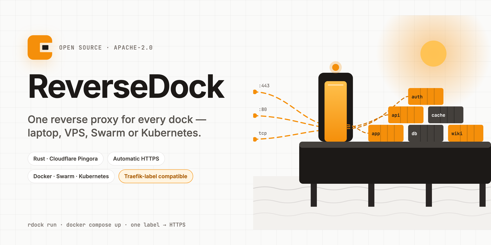

<p align="center">
  
</p>

# ReverseDock

[](https://github.com/Docker-Hunterpedia/ReverseDock/actions/workflows/ci.yml)
[](LICENSE)
[](docs/07-roadmap.md)
[](CONTRIBUTING.md#branches-and-commits)

> One reverse proxy for a laptop, a VPS, a Docker Swarm, or a Kubernetes cluster.
> Rust, built on [Cloudflare Pingora](https://github.com/cloudflare/pingora). 100 % free and open source (Apache-2.0). No account, no telemetry, no paid tier.

**Status: design phase.** No code yet — the plan is complete and lives in [`docs/`](docs/README.md).

## What it will do

- **Traefik's discovery:** Docker, Compose, Swarm, Kubernetes Gateway API — with `rdock.*` labels *and* your existing `traefik.*` labels.
- **Caddy's HTTPS:** automatic certificates by default (HTTP-01, TLS-ALPN-01, DNS-01 with Cloudflare first), ARI-aware renewals ready for 45-day certificates.
- **NGINX's HTTP features:** rewrites, redirects, headers, compression, static files, caching, TCP/UDP.
- **HAProxy's reliability:** health checks, load-balancing policies, retries with budgets, circuit breakers, limits.
- **A Cloudflare-style dashboard** embedded in the single binary, plus a REST API with history and rollback.
- **Cloudflare-aware:** trusted IP sync, `CF-Connecting-IP`, Origin CA, Authenticated Origin Pulls, Tunnel examples, Access JWT.

```yaml
# docker-compose.yml — one label is enough
services:
  app:
    image: ghcr.io/me/app
    labels:
      rdock.host: app.example.com      # route + service + automatic HTTPS
```

## Documentation

| | |
|---|---|
| [Vision](docs/01-vision.md) | why, audiences, principles, non-goals |
| [Research](docs/02-research.md) | verified facts and competitor landscape (Oct 2026) |
| [Feature matrix](docs/03-feature-matrix.md) | 171 capabilities vs NGINX, Traefik, Caddy, HAProxy, Envoy, Pingap, Pingora |
| [Requirements](docs/04-requirements.md) | Basics · Medium traffic · High traffic · Features · Works with |
| [Architecture](docs/05-architecture.md) | the engineering plan |
| [Repo layout](docs/06-repo-layout.md) | crates, conventions, CI, releases |
| [Roadmap](docs/07-roadmap.md) | M0 → v1.0 with acceptance criteria |
| [Design system](docs/08-design-system.md) | Harbor UI · dashboard mock `docs/design/dashboard-mock.html` ([preview](https://claude.ai/artifact/Svy4mzFgfqoWie4aGmHrxB)) · banner & logo sources in `docs/assets/` ([canvas](https://claude.ai/artifact/Kg8V5vPCPyYbokXwYEH8iu)); the in-repo files are canonical, the links are private previews |
| [Decisions](docs/decisions/README.md) | ADRs |

## Roadmap at a glance

`M0 foundations → v0.1 hello proxy → v0.2 Docker-native → v0.3 automatic HTTPS → v0.4 production reliability → v0.5 management (dashboard + API) → v0.6 Swarm + L4 + static → v0.7 Kubernetes → v0.8 cache + plugins → v0.9 scale + HTTP/3 (experimental) → v1.0`

## Contributing

The project is in the design phase: reviews of the plan, research corrections and real-world Traefik label sets are the most valuable contributions right now.

- [CONTRIBUTING.md](CONTRIBUTING.md): issues, PR rules, Conventional Commits, DCO sign-off (`git commit -s`)
- [Code of Conduct](CODE_OF_CONDUCT.md) · [Governance](GOVERNANCE.md) · [Support](SUPPORT.md)
- Security problems: [SECURITY.md](SECURITY.md), never a public issue
- Questions: [Discussions](https://github.com/Docker-Hunterpedia/ReverseDock/discussions)

`main` is protected: every change goes through a reviewed pull request with green checks.

## License

[Apache-2.0](LICENSE). Free forever: no CLA, no open-core, no telemetry ([ADR-0005](docs/decisions/0005-license-apache2-dco.md)).
