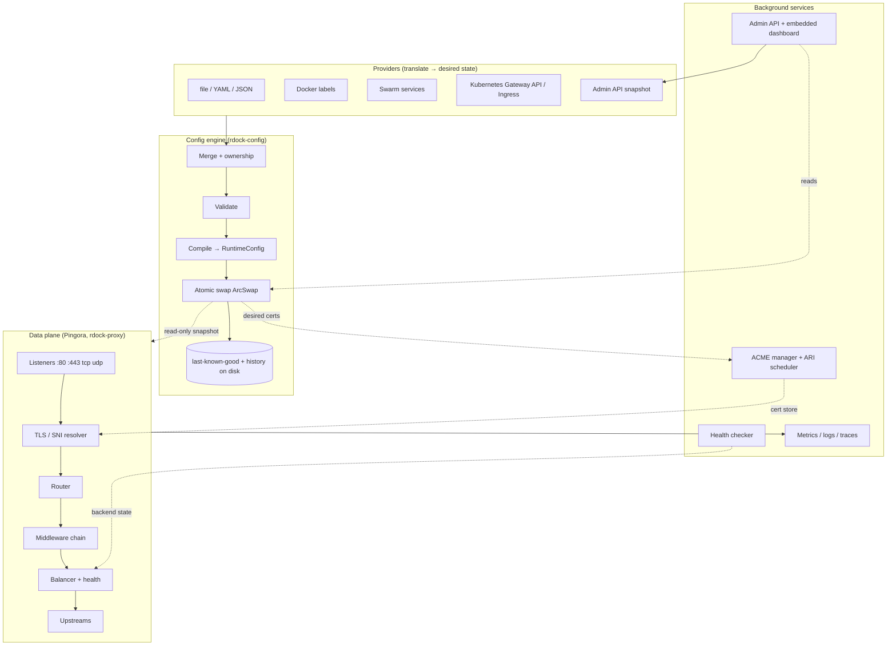
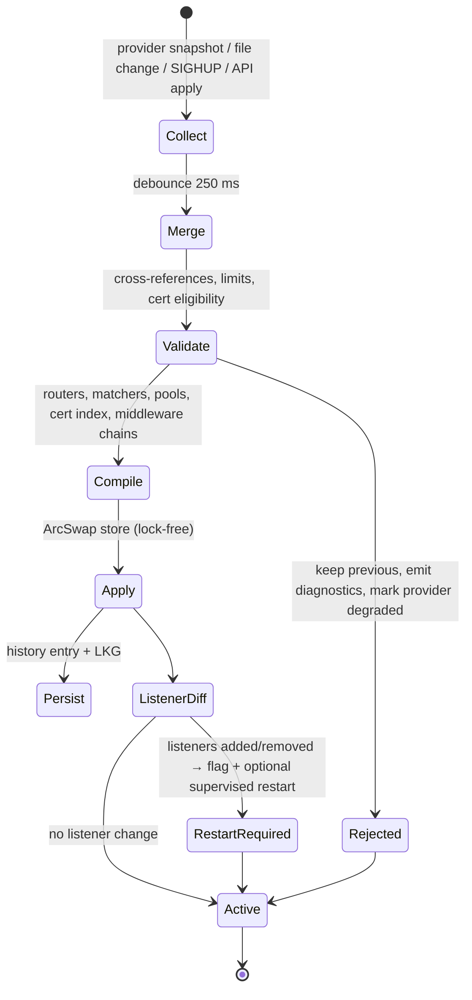
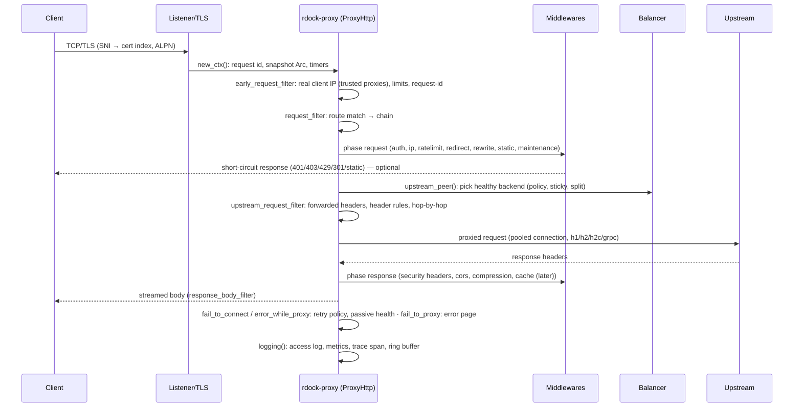
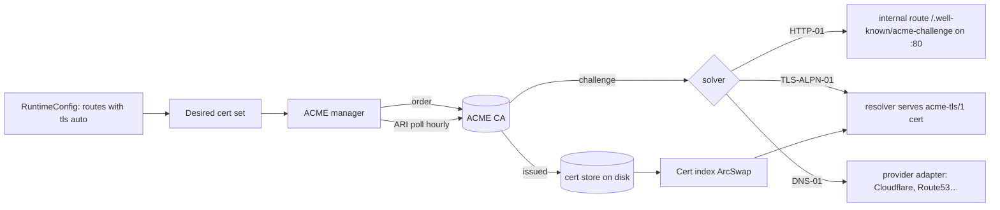

# ReverseDock — Architecture

The main engineering plan. Diagrams are Mermaid (GitHub renders them). Decisions with trade-offs are recorded as ADRs in [`decisions/`](decisions/).

## 1. Shape of the system



Rules that the diagram encodes:

1. **Everything flows one way:** providers → engine → immutable `RuntimeConfig` → data plane. The data plane never calls providers, the admin API, or disk on the request path.
2. **One process, several services.** Pingora's `Server` hosts: one HTTP proxy service per listener group, L4 services, and background services (providers, ACME, health checks, metrics, admin). All share graceful shutdown/upgrade.
3. **Optional parts are optional at runtime, not at compile time.** Docker, Swarm, Kubernetes and the dashboard are enabled in config; the default binary ships them all (Cargo feature table in [06 §2](06-repo-layout.md); `cache` and `http3` are opt-in builds).

## 2. Crate map

```
rdock-model          desired-state types (serde + schemars) · validation rules · JSON Schema export
rdock-rules          Traefik-v3-compatible rule grammar: parser → AST → matcher
rdock-config         loaders (yaml/json/env/secret files) · provider registry · merge/ownership · compile · snapshots · history · LKG
rdock-proxy          Pingora ProxyHttp impl · listener setup · router · middleware runtime · forwarded headers · error pages · L4 proxies
rdock-tls            rustls SNI resolver · cert store/index · TLS policies · mTLS · PROXY protocol glue · local CA
rdock-acme           instant-acme client · challenge solvers (HTTP-01, TLS-ALPN-01, DNS-01) · `DnsProvider` trait · ARI scheduler · storage
rdock-balancer       BackendSelection impls (wrr, least-conn, p2c, hash) · active/passive health · retry policy · circuit breaker · outlier detection
rdock-middleware     built-ins: headers, redirect, rewrite, strip/add prefix, basic/forward auth, jwt, cors, compress, ip filter, rate limit, errors, static, maintenance, mirror
rdock-limits         token bucket · concurrency gate with queue · body/header limits · bounded-cardinality maps
rdock-observability  tracing setup · access log formatter + redaction · metrics registry · OTLP exporter · 15-min ring buffer for the dashboard
rdock-admin          axum API (/api/v1) · OpenAPI (utoipa) · auth (tokens, sessions, RBAC) · SSE streams · embedded dashboard (rust-embed)
rdock-cloudflare     IP-range sync · Cloudflare `DnsProvider` impl (depends on rdock-acme) · Access JWT validator · Origin CA helpers
rdock-cache          (P2) HTTP cache on pingora-cache: memory + disk storage, purge, SWR/SIE
rdock-plugins        (P2/P3) native plugin trait, WASM host (wasmtime), out-of-process agent client
rdock-control        (P3) optional control plane: config rollout ACK/NACK, shared cert storage, distributed limits
rdock-provider-file  · rdock-provider-docker · rdock-provider-swarm · rdock-provider-kubernetes · rdock-provider-api
rdock-migrate        traefik (labels + dynamic yaml) → rdock.yaml · nginx subset (later)
rdock-testkit        spawn upstream servers, Pebble ACME, toxiproxy, docker-in-CI helpers
rdock                the binary (clap): run / validate / reload / status / config / cert / migrate / trust / version
```

Dependency direction: `rdock` → `rdock-admin`, `rdock-proxy`, providers → `rdock-config` → `rdock-model` ← `rdock-rules`. No crate depends on `rdock-admin` or on any provider. `rdock-proxy` depends on `rdock-tls`, `rdock-balancer`, `rdock-middleware`, `rdock-limits`, `rdock-observability`. `rdock-cloudflare` depends on `rdock-acme` (it implements its `DnsProvider` trait).

## 3. Desired-state model (`rdock-model`)

The model is deliberately a **superset of Traefik's dynamic configuration** (entrypoints → routers → services → middlewares) so that Traefik labels, Traefik YAML and Kubernetes routes all map onto it without reinterpretation.

| Entity | Purpose | Key fields |
|---|---|---|
| `Listener` | A bound socket | `address`, `protocol` (`http`,`https`,`tcp`,`udp`), `tls` policy, `proxy_protocol`, `http3` (later) |
| `Route` | HTTP match → service | `match` (rule string **or** structured), `listeners`, `priority`, `middlewares[]`, `service`, `tls` (`auto` / cert ref / dns provider / off) |
| `Service` | A backend pool | `backends[]` (`address`, `weight`, `unix:` sockets), `scheme` (`http`,`https`,`h2c`,`grpc`), `load_balancer`, `health`, `retries`, `timeouts`, `tls` (upstream), `sticky`, `mirror`, `split[]` |
| `Middleware` | Typed, reusable policy | `type` + typed config (see §8) |
| `TcpRoute`/`UdpRoute` + `TcpService` | L4 routing | `match: HostSNI(...)`, `passthrough`, `tls` termination |
| `Certificate` | Manual cert | `cert`, `key` (paths or secret refs) |
| `Acme` | CA + challenge settings | `email`, `ca`, `profile`, `challenges[]`, `dns_providers{}`, `storage` |
| `Provider*` | Per-provider settings | docker/swarm/k8s/file/api |
| `Security` | Global trust & limits | `trusted_proxies[]`, `client_ip_header`, `limits` |
| `Admin`, `Observability` | Management & telemetry | listener, auth, log/metrics/tracing settings |

Every object carries metadata the user never writes: `owner` (`file:/etc/rdock/rdock.yaml`, `docker:myproj/app`, `k8s:ns/name`, `api`), `source_ref`, `generation`, `warnings[]`. Names are provider-namespaced like Traefik (`app@docker`, `office-only@file`); references without `@` resolve inside the same provider first, then globally if unique.

### 3.1 Canonical YAML (what a user writes)

```yaml
# $schema: https://reversedock.dev/schema/v1.json   (domain TBD; the schema is also committed at schema/rdock.v1.json)
listeners:
  web:       { address: ":80" }
  websecure: { address: ":443", tls: { policy: intermediate } }

defaults:
  listeners: [websecure]
  redirect_http_to_https: true
  tls: auto

acme:
  email: ops@example.com
  ca: letsencrypt                 # or a directory URL; staging: true for tests
  profile: tlsserver              # classic | tlsserver | shortlived
  challenges: [http-01, tls-alpn-01]
  dns_providers:
    cf: { type: cloudflare, api_token: ${file:/run/secrets/cf_token} }

routes:
  app:
    match: "Host(`app.example.com`)"             # Traefik grammar, or:
    # match: { hosts: [app.example.com], path_prefix: /api, methods: [GET, POST] }
    service: app
    middlewares: [secure-headers, api-limit]
  wildcard-tenant:
    match: "HostRegexp(`^[a-z0-9-]+\\.tenants\\.example\\.com$`)"
    service: tenants
    tls: { auto: true, dns_provider: cf, domains: ["*.tenants.example.com"] }

services:
  app:
    backends: [{ address: "10.0.0.5:3000" }, { address: "10.0.0.6:3000", weight: 2 }]
    scheme: http
    load_balancer: { policy: least_conn }
    health:
      active:  { path: /healthz, interval: 10s, timeout: 2s, healthy: 2, unhealthy: 3 }
      passive: { failures: 5, window: 30s, ejection: 30s }
    retries:  { attempts: 2, on: [connect, reset, timeout], budget_percent: 20 }   # status-code retries are P2 (ADR-0010)
    timeouts: { connect: 5s, read: 60s, write: 60s, idle: 90s }
  tenants:
    backends: [{ address: "unix:///run/tenants.sock" }]

middlewares:
  secure-headers: { type: headers, response: { set: { X-Frame-Options: DENY, Referrer-Policy: strict-origin-when-cross-origin } } }
  api-limit:      { type: rate_limit, key: client_ip, average: 100, burst: 200, period: 1s }
  office-only:    { type: ip_allow, cidrs: [10.0.0.0/8, 203.0.113.0/24] }
  sso:            { type: forward_auth, address: http://authelia:9091/api/verify, copy_headers: [Remote-User, Remote-Groups] }

providers:
  file:   { paths: ["/etc/rdock/conf.d/*.yaml"], watch: true }
  docker: { endpoint: unix:///var/run/docker.sock, expose_by_default: false, network: proxy, traefik_labels: true }

security:
  trusted_proxies: [cloudflare, 10.0.0.0/8]      # 'cloudflare' = auto-synced ranges
  client_ip_header: auto                          # CF-Connecting-IP on verified CF hop, else rightmost-untrusted XFF
  limits: { max_header_bytes: 32KiB, max_body_bytes: 100MiB }

admin:
  listener: 127.0.0.1:2080
  dashboard: true

observability:
  access_log: { format: json, redact: [authorization, cookie, set-cookie] }
  metrics: { prometheus: true }
  tracing: { otlp: http://tempo:4318, sample_ratio: 0.1 }
```

Everything is optional. With **no file at all**, `rdock run` starts `:80`/`:443`, the Docker provider, automatic HTTPS and the admin API on localhost.

## 4. Providers and the merge engine

```rust
#[async_trait]
pub trait Provider: Send + Sync {
    fn id(&self) -> ProviderId;                       // "docker", "file", "kubernetes", "api"
    async fn run(self: Arc<Self>, tx: watch::Sender<Snapshot>, shutdown: Shutdown) -> Result<()>;
    fn health(&self) -> ProviderHealth;               // Connected / Degraded(reason) / Stopped
}

pub struct Snapshot {                                  // a provider's complete view, never a diff
    pub provider: ProviderId,
    pub generation: u64,
    pub objects: DesiredState,                         // routes, services, middlewares, certs, tcp routes …
    pub diagnostics: Vec<Diagnostic>,                  // unsupported labels, missing ports, …
}
```

**Merge rules (deterministic, documented, tested):**

1. A provider always emits a *complete* snapshot. The engine replaces that provider's previous contribution wholesale. Partial failure inside a provider (e.g. one container with a bad label) produces diagnostics and skips that object, never the whole snapshot.
2. Objects are namespaced by provider (`name@provider`). Two providers may define the same name; references resolve same-provider first.
3. If a provider's snapshot fails validation, the engine keeps that provider's **previous valid snapshot**, marks the provider `Degraded`, and still applies everyone else's changes.
4. Two routes with overlapping matches compile fine; evaluation order is `priority desc → rule length desc → provider priority (file > api > kubernetes > swarm > docker) → name`. The loser is flagged **shadowed** in diagnostics/dashboard.
5. A referenced object that does not exist → the referencing object is rejected with a diagnostic (`route app@docker references middleware sso@file which does not exist`).
6. The `api` provider persists its snapshot to `$RDOCK_DATA_DIR/api/snapshot.json`; it is the only provider the dashboard can write to. File/Docker/K8s objects are read-only in the UI (shown with their origin).
7. Secrets never come from labels. A label value `${file:..}` or `${env:..}` is rejected with a diagnostic.

## 5. Config engine pipeline



- **Immutable snapshots:** `RuntimeConfig` is an `Arc` stored in an `ArcSwap`. Each request clones the `Arc` once in `new_ctx`; the request sees one consistent config for its lifetime even if a reload happens mid-flight.
- **Compile step** pre-computes: host trie (exact + wildcard), per-host path radix trees, regex set, middleware chains as `Vec<Arc<dyn Middleware>>`, backend pools with health state carried over (health state is keyed by `address`, so a reload never resets a backend to "unknown").
- **History:** `$RDOCK_DATA_DIR/state/history/<unix-ms>-<hash>.json` (last 50 by default, plus the diff summary). **LKG** `state/lkg.json` is loaded at boot when providers are slow/unavailable, so a reboot with Docker not yet up still serves yesterday's routes.
- **Listener changes** (new port, protocol change) cannot be applied in place: Pingora binds listeners at service start, and a self-upgrade is unsafe when `rdock` is PID 1 in a container (the admin socket is not transferred either). The engine applies everything else, marks the generation `restart required`, surfaces it (CLI, API, dashboard, `rdock_restart_required` metric) and restarts only when `--restart-on-listener-change` is set (the official image sets it; the container supervisor brings the process back). Zero-downtime listener changes (supervisor + fd transfer) are the v0.9 track H-PERF-04. ([ADR-0008](decisions/0008-listener-changes-via-self-upgrade.md))
- **Triggers:** file watch (notify, debounced), `SIGHUP`, `rdock reload`, `POST /api/v1/config/apply`, provider events. `rdock validate` runs the same pipeline up to *Compile* and exits non-zero on error with the diagnostics list.

## 6. Request lifecycle (Pingora hooks)



| Pingora hook | ReverseDock responsibility |
|---|---|
| `new_ctx` | Allocate `RequestCtx { snapshot: Arc<RuntimeConfig>, request_id, timings, route: None, attempts: 0 }` |
| `early_request_filter` | Compute `client_ip` from peer + trusted proxies; apply global header/URI limits; set `X-Request-ID` |
| `request_filter` | Route match (host trie → path tree → rule evaluation), listener check, store route in ctx; run middleware phase `request`; may return a response and `true` |
| `upstream_peer` | Service lookup, split/canary pick, sticky lookup, balancer selection → `HttpPeer` with scheme, SNI, timeouts, mTLS, h2c |
| `upstream_request_filter` | Forwarded headers (`X-Forwarded-*`, `Forwarded`), host header policy (`pass_host_header`), route header mutations, strip hop-by-hop |
| `upstream_response_filter` / `response_filter` | Middleware phase `response`; `Alt-Svc` (http3 later); `Server` header policy |
| `response_body_filter` | Streaming transforms (compression via Pingora modules; body rewrites later) |
| `request_body_filter` | Body size accounting (chunked bodies), upload rate limit |
| `fail_to_connect` | Mark connect errors retryable (`e.set_retry(true)`) when the policy allows: idempotent method or `retry_non_idempotent`, attempts left, budget available; passive-health signal for that backend |
| `error_while_proxy` | Same decision for errors **before upstream response headers** (reset, timeout) when the request body is replayable; after headers nothing is retried (ADR-0010) |
| `fail_to_proxy` | Terminal: custom error page, `Retry-After`, error metrics; no retry here |
| `logging` | Access log line, metrics, OTel span end, dashboard ring buffer, audit of blocked requests |
| `response_cache_filter` / cache hooks | Cache track (P2) |

**Real client IP algorithm (B-NET-08/W-CF-02):** start from the TCP peer. If the peer is in `trusted_proxies`, walk `X-Forwarded-For` from right to left, skipping trusted addresses; the first untrusted one is the client. If the peer is a verified Cloudflare range and `client_ip_header: auto`, use `CF-Connecting-IP` instead. If the peer is untrusted, all forwarded headers are ignored and **overwritten** before reaching the upstream.

## 7. Routing engine (`rdock-rules`, `rdock-proxy::router`)

- Grammar (Traefik v3 compatible): `Host`, `HostRegexp`, `Path`, `PathPrefix`, `PathRegexp`, `Method`, `Header`, `HeaderRegexp`, `Query`, `QueryRegexp`, `ClientIP`, combined with `&&`, `||`, `!`, parentheses. Parsed once at compile time into an AST; `Host`/`PathPrefix` conjunctions are lifted into the host trie / path tree index so the common case is O(log n), and only the residual AST is evaluated per request.
- Regexes use the `regex` crate (guaranteed linear time); size-limited at compile; `(?i)` allowed; backreferences impossible by construction.
- Path normalisation before matching: percent-decoding of unreserved chars, dot-segment removal, duplicate slash collapse (configurable), never decode `%2F`. The *original* path is forwarded unless a rewrite applies.
- Priority: explicit `priority` > rule length (Traefik semantics) > provider order > name. Shadowed routes reported.
- Structured `match` (`hosts`, `path`, `path_prefix`, `path_regex`, `methods`, `headers`, `query`, `client_ips`) compiles to the same AST, so Kubernetes `HTTPRoute` matches and Traefik rules share one engine.

## 8. Middleware model (`rdock-middleware`)

```rust
pub trait Middleware: Send + Sync {
    fn name(&self) -> &str;
    fn phases(&self) -> Phases;                                       // bitflags: REQUEST | UPSTREAM_REQUEST | RESPONSE | RESPONSE_BODY | LOG
    async fn on_request(&self, s: &mut Session, ctx: &mut RequestCtx) -> Flow;   // Continue | Respond(Response) | Reject(Status, reason)
    async fn on_upstream_request(&self, req: &mut RequestHeader, ctx: &mut RequestCtx);
    async fn on_response(&self, resp: &mut ResponseHeader, ctx: &mut RequestCtx);
    fn on_response_body(&self, body: &mut Option<Bytes>, end: bool, ctx: &mut RequestCtx);
    fn on_log(&self, ctx: &RequestCtx);
}
```

Built-ins (P0 unless noted): `headers`, `redirect` (scheme/regex), `rewrite`/`strip_prefix`/`add_prefix`/`replace_path`, `basic_auth`, `forward_auth`, `ip_allow`/`ip_deny`, `rate_limit`, `inflight_limit` (P1), `cors`, `compress` (gzip P0; br/zstd P1), `errors` (custom pages), `maintenance`, `static` (P1), `jwt` (P1), `mirror` (P1), `buffering` (P1), `cache` (P2), `wasm` (P3), `agent` (out-of-process, P3). Retries and circuit breakers are **service** fields (§9), not middlewares; Traefik's `retry.*` label maps onto `services.<s>.retries` and `inflightreq.*` onto `inflight_limit`.

Chains are per route, evaluated in declared order for `request`, **reverse** order for `response` (like Traefik/Envoy onion). Each middleware declares what it needs (body? headers only?) so streaming is preserved unless a middleware explicitly buffers.

## 9. Load balancing, health, retries (`rdock-balancer`)

- Reuses Pingora's `Weighted<RoundRobin>`, `Weighted<Random>`, `Consistent` (ketama) and FNV selectors; implements `BackendSelection` ourselves for `least_conn`, `least_requests`, `p2c`, `ip_hash`, `header_hash`, `cookie_hash`.
- **Active health**: Pingora `HealthCheck` trait impls for HTTP(S) (status + optional body substring), TCP, gRPC health v1. Runs as a background service; state keyed by backend address survives reloads.
- **Passive health**: `fail_to_proxy`/5xx/timeouts feed a sliding window per backend → ejection for `ejection` seconds → slow-start weight ramp on return.
- **Retries**: decided in Pingora's `fail_to_connect` and `error_while_proxy` hooks, i.e. for connect failures and errors **before upstream response headers**; only when (method is idempotent **or** route opts in) **and** the request body is replayable (empty or buffered) **and** `attempts < max` **and** the retry budget (ratio of retries to requests over 10 s) is not exceeded. Each retry picks a *different* backend if one is available. Retrying on upstream **status codes** (502/503/504) is impossible without patching `pingora-proxy` (Zentinel carries a `should_retry_response` patch); it is a P2 item gated on an upstream PR ([ADR-0010](decisions/0010-retry-semantics.md)).
- **Circuit breaker**: per backend; closed → open after `failures` in `window` → half-open after `cooldown` with 1 probe; metrics expose state.
- **Traffic split**: `service.split: [{service: v1, weight: 90}, {service: v2, weight: 10}]` evaluated before selection; sticky cookies pin the split choice.

## 10. TLS and certificates (`rdock-tls`, `rdock-acme`)



- **Resolver:** `rdock-tls` implements `rustls::server::ResolvesServerCert`. Lookup order: ALPN `acme-tls/1` → challenge map; exact SNI; wildcard (one label); `defaults.certificate`; else TLS alert `unrecognized_name`. The index is rebuilt (cheap) on every config apply and every issuance. Pingora 0.9's `Acceptor::from_server_config` lets us own the full `ServerConfig` (versions, ciphers, ALPN, client auth).
- **Desired-cert computation:** every `Host(...)` in a route with `tls: auto` on a TLS listener, deduplicated, grouped per route's `tls.domains` if given. `HostRegexp` hosts are *not* eligible (on-demand TLS, P2, with mandatory `ask` authorization endpoint).
- **ACME manager state machine per cert name:** `Missing → Ordering → Challenging → Issued → RenewDue(ARI window) → Ordering…`; `Failed(backoff)` with exponential backoff capped at 24 h and an alert after 3 failures. Concurrency limit per CA; duplicate suppression; staging toggle; `shortlived` (≈160 h) certificates renew roughly every 4 days (⅔ of lifetime) unless ARI says otherwise.
- **Storage:** `$RDOCK_DATA_DIR/acme/accounts/<ca>/account.json`, `acme/certs/<name>/{cert.pem,chain.pem,key.pem,meta.json}` with atomic rename; `meta.json` holds issuer, SANs, not_before/after, profile, ARI window, last error. Shared storage (S3/K8s Secret) is a P3 `CertStorage` impl.
- **Renewal:** poll ARI every hour (cheap GET). Without ARI: renew at ⅔ lifetime. Renewal failures keep serving the existing cert and raise `rdock_cert_renewal_failed` + alert.
- **Policies:** `modern` (TLS 1.3 only), `intermediate` (1.2+1.3, Mozilla list), `custom`. Session tickets with rotating keys; TLS offload pool size configurable.
- **Local dev:** `rdock trust` creates a local CA (rcgen) and installs it into the OS trust store (opt-in), like Caddy's `local_certs`.

## 11. Docker provider (`rdock-provider-docker`)

- **Connection:** `bollard` over `unix:///var/run/docker.sock`, `tcp://` or a socket proxy. Calls used: `containers/json`, `containers/{id}/json`, `networks`, `events` (filters: `container` start/stop/die/health_status/update, `network` connect/disconnect). Nothing else — a read-only socket proxy (e.g. `tecnativa/docker-socket-proxy` with `CONTAINERS=1 NETWORKS=1 EVENTS=1`) is sufficient.
- **Loop:** full list at start → stream events → re-list on each relevant event (coalesced) → periodic full reconcile every 60 s as a safety net.
- **Eligibility:** `rdock.enable=true` (or `traefik.enable=true` with `traefik_labels: true`), or `expose_by_default: true` and not `rdock.enable=false`. Stopped/unhealthy containers are kept in the snapshot with `healthy: false` so draining works.
- **IP selection:** the network named in `rdock.network`/`traefik.docker.network`, else the provider's `network`, else the single network the container is on, else diagnostic. Host-network containers have no bridge IP: the provider uses `providers.docker.host_address` (default `127.0.0.1`) and the port from `rdock.port` (required in that case).
- **Port selection:** `rdock.port` / `traefik.http.services.<s>.loadbalancer.server.port` > single `ExposedPort` > diagnostic *"container app has 3 exposed ports (80, 443, 9000); set rdock.port"*.

**Native labels** (shorthand expands to one route + one service + auto TLS):

```yaml
labels:
  rdock.enable: "true"
  rdock.host: app.example.com             # also "a.example.com,b.example.com"
  rdock.port: "3000"
  rdock.path: /                           # PathPrefix; optional
  rdock.tls: auto                         # auto | off | dns:cf (wildcard via DNS-01)
  rdock.middlewares: secure-headers@file,api-limit
  # full form, any number of routes/services/middlewares per container:
  rdock.routes.api.match: "Host(`api.example.com`) && PathPrefix(`/v1`)"
  rdock.routes.api.service: api
  rdock.routes.api.priority: "10"
  rdock.services.api.port: "4000"
  rdock.services.api.scheme: h2c
  rdock.services.api.health.active.path: /healthz
  rdock.middlewares.robots.type: headers
  rdock.middlewares.robots.response.set.X-Robots-Tag: none
```

**Traefik v3 compatibility subset (conformance-tested, v0.2):**

| Traefik label | Mapping |
|---|---|
| `traefik.enable` | eligibility |
| `traefik.docker.network` | network selection |
| `traefik.http.routers.<r>.rule / priority / entrypoints / service / middlewares` | route fields; entrypoint names map via `providers.docker.entrypoints: {web: web, websecure: websecure}` |
| `traefik.http.routers.<r>.tls`, `.tls.certresolver`, `.tls.domains[n].main/sans` | `tls: auto` (any resolver name → default ACME), explicit SANs |
| `traefik.http.services.<s>.loadbalancer.server.port / scheme / url`, `.passhostheader`, `.sticky.cookie.*`, `.healthcheck.*`, `.serverstransport` (warn) | service fields |
| `traefik.http.middlewares.<m>.headers.*`, `redirectscheme.*`, `redirectregex.*`, `stripprefix.*`, `addprefix.*`, `replacepath.*`, `replacepathregex.*`, `basicauth.*`, `ratelimit.*`, `ipallowlist.*`, `compress.*`, `forwardauth.*`, `errors.*`, `retry.*`, `inflightreq.*`, `buffering.*` | middleware types |
| `traefik.tcp.routers.<r>.rule (HostSNI) / entrypoints / tls.passthrough`, `traefik.tcp.services.<s>.loadbalancer.server.port` | L4 (v0.6) |
| anything else (`plugin.*`, `chain`, `digestauth`, `passtlsclientcert` …) | **diagnostic warning** with the exact label, visible in `rdock status` and the dashboard |

## 12. Swarm and Kubernetes (summary)

- **Swarm** (`rdock-provider-swarm`, P1): reads `services` + `tasks`; labels from `Spec.Labels` (i.e. `deploy.labels`); endpoint mode `vip` (service VIP on the overlay) or `dnsrr`/tasks (each running task's IP with health). Proxy runs as a global service on manager/worker nodes attached to the ingress/overlay network.
- **Kubernetes** (`rdock-provider-kubernetes`, P2): a controller built on `kube` 4.x + the `gateway-api` crate: watches `GatewayClass` (`controllerName: reversedock.dev/gateway-controller`), `Gateway`, `HTTPRoute`, `GRPCRoute`, `TLSRoute`, `TCPRoute`, `UDPRoute`, `ReferenceGrant`, `ListenerSet` (once Standard), `Service`/`EndpointSlice`, `Secret` (TLS). Writes status conditions. Leader election via `Lease`. Gateway API conformance suite runs in CI on `kind`. `Ingress` v1 support is a translation layer for migrations. Deployed by Helm as a `Deployment` (or `DaemonSet` + hostPorts) with the data plane and controller in the same binary (`--mode kubernetes`).

## 13. Admin API and dashboard (`rdock-admin`)

- Separate `axum` server on `admin.listener` (default `127.0.0.1:2080`); exposing it on a proxy route requires an explicit route + middleware (e.g. `forward_auth`) — never implicit.
- **Auth:** bootstrap token printed/written at first start (`$RDOCK_DATA_DIR/admin/bootstrap-token`); users with argon2id passwords (dashboard sessions: `SameSite=Strict` cookie + CSRF token); API tokens with scopes `read`, `write`, `admin`, optional expiry and IP allow-list; roles `viewer`, `operator`, `admin`. Every write is audit-logged (`who, when, what, diff hash, result`).
- **Resources (`/api/v1`):** `config` (GET effective, PUT replace API snapshot, PATCH, `POST /config/validate`, `/config/apply`, `/config/history`, `/config/rollback/{id}`), `routes`, `services`, `middlewares`, `certificates` (`POST /certificates/{name}/renew`), `listeners`, `providers` (status + diagnostics), `backends` (health, drain/undrain), `logs/stream` (SSE), `events/stream` (SSE), `metrics/summary` (ring buffer), `cache/purge` (P2), `users`, `tokens`, `audit`. OpenAPI 3.1 served at `/api/openapi.json`.
- **Dashboard:** static SPA embedded with `rust-embed`, served at `/` of the admin listener, talks only to `/api/v1`, makes **no external requests** (fonts and icons bundled). See [design system](08-design-system.md).

## 14. Observability (`rdock-observability`)

- **Access log** (JSON, one line per request): `ts, request_id, trace_id, client_ip, method, host, path, query(len), proto, status, bytes_in, bytes_out, duration_ms, upstream_addr, upstream_connect_ms, upstream_ttfb_ms, route, service, listener, tls_version, tls_cipher, sni, user_agent, referer, cf_ray, retries, cache_status, error`. Redaction list applied before serialisation; sampling by status class.
- **Metrics** (Prometheus): `rdock_http_requests_total{listener,route,service,method,status_class}`, `rdock_http_request_duration_seconds` (histogram), `rdock_upstream_duration_seconds`, `rdock_upstream_backend_healthy{service,backend}`, `rdock_upstream_connections{...}`, `rdock_tls_handshakes_total{version,resumed}`, `rdock_cert_expiry_timestamp_seconds{name}`, `rdock_cert_renewal_failed_total`, `rdock_ratelimit_rejected_total{middleware}`, `rdock_config_generation`, `rdock_provider_state{provider}`, process/Tokio runtime metrics. Label cardinality is bounded by config (route/service names), never by host/path values.
- **Tracing:** `tracing` spans per request; OTLP export; `traceparent`/`tracestate` propagated to upstream; `baggage` optional.
- **Dashboard feed:** a 15-minute ring buffer of per-second counters and latency sketches (DDSketch) per route — no Prometheus needed for live charts.

## 15. Security model

| Threat | Control |
|---|---|
| Client-IP spoofing | Forwarded headers trusted only from `trusted_proxies`; Cloudflare ranges auto-synced and verified; untrusted headers stripped |
| Request smuggling / desync | Pingora 0.9 strict parsing; we reject `Transfer-Encoding` + `Content-Length` conflicts, obs-fold, invalid `:authority`; differential fuzz in CI |
| Admin takeover | Localhost bind, tokens with scopes, rate-limited login, audit log, no default credentials, CSRF on sessions |
| Docker socket abuse | Read-only API usage, socket-proxy docs, no `exec`/`create` calls, labels cannot inject secrets |
| Certificate abuse (on-demand TLS) | Disabled by default; requires `ask` endpoint; per-IP issuance rate limits |
| Path traversal in static | Canonicalised root, symlink policy, deny dotfiles by default |
| Resource exhaustion | Header/body/URI limits, bounded HTTP/2 streams/windows, connection and inflight limits, rate limiter with bounded key cardinality, timeouts everywhere |
| Secrets leakage | Redaction in logs, secrets referenced by path, never echoed by API (`***`), config export masks them |
| Supply chain | `cargo-deny`, `cargo-audit`, pinned deps, signed releases, SBOM, minimal images |
| Memory safety | Rust, `#![forbid(unsafe_code)]` in all `rdock-*` crates; unsafe only in audited dependencies |

## 16. Performance design

- Tokio multi-thread runtime per Pingora service; `threads` default = cores; `SO_REUSEPORT` listeners; configurable socket buffers (Pingora 0.9).
- Hot path allocations: route match without allocation (borrowed `&str` on trie), header mutations in place, `Bytes` body passthrough, middlewares declare body needs.
- Lock-free config reads (`ArcSwap`), sharded rate-limit maps, atomics for counters, DDSketch for latency.
- TLS: handshake offload pool, session resumption, ECDSA certs by default (smaller handshakes), `aws-lc-rs` provider.
- Connection pooling per `HttpPeer` with limits and idle eviction; HTTP/2 upstream multiplexing where the backend supports it.
- Benchmarks (`benchmarks/`) run `oha`/`wrk2`/`k6` scenarios against identical NGINX/Traefik/Caddy/HAProxy configs in Docker with pinned CPUs; results published per release.

## 17. Layer 4 (`rdock-proxy::l4`, P1)

- `listeners.<name>.protocol: tcp|udp` are Pingora listening services: TCP routes implement `pingora_core::apps::ServerApp` under `services::listening::Service`, so they get Pingora's fd transfer, PROXY-protocol pre-TLS callback and graceful shutdown for free; UDP (P2) is a Tokio `UdpSocket` loop registered as a background service (sessions are short, no fd transfer needed).
- TCP: optional PROXY protocol v1/v2 parse (only from `trusted_proxies`); optional TLS termination; `HostSNI()` routing via ClientHello peek without termination (passthrough); byte-copy with `tokio::io::copy_bidirectional`, idle timeouts, per-connection byte metrics; outbound PROXY protocol per service.
- UDP (P2): session table keyed by `(client, listener)`, idle timeout, per-session backend affinity, size limits.
- Shares `rdock-balancer` (TCP health checks) and `rdock-limits` (connection caps).

## 18. HTTP/3 track (P3, experimental)

- Cargo feature `http3`; build variant with BoringSSL (`pingora` `boringssl` feature) + `tokio-quiche`. The default build stays rustls-only.
- Ingress first: a UDP socket on the same port as the TLS listener, QUIC handshake with the same cert index. Pingora's server `Session` is a closed H1/H2 type, so feeding h3 into `ProxyHttp` needs either a maintained `pingora-core` patch (what PR #514 did) or an h3 front-end forwarding over an internal h2c hop into the normal pipeline; the track starts with the hop (no fork) and measures its cost. `Alt-Svc: h3=":443"` injected by `rdock-proxy`. Upstream HTTP/3 is out of scope until Pingora provides a connector.
- Ships as "experimental" until h3i/quiche interop tests and soak tests pass.

## 19. Cache track (P2)

- Built on `pingora-cache` pinned to the Pingora version in use; storage: `pingora-memory-cache` (memory tier) + our disk `Storage` impl (segmented files, size quota, LRU eviction, crash-safe index).
- RFC 9111 semantics (`Cache-Control`, `Vary`, conditional revalidation), `stale-while-revalidate`, `stale-if-error`, request coalescing (Pingora cache lock), bypass rules (cookies/auth), per-route TTL overrides, `cache_status` in logs/metrics, purge API by URL and by tag (`Cache-Tag`).

## 20. Failure modes (what happens when…)

| Failure | Behaviour |
|---|---|
| Docker socket unavailable at boot | Load LKG snapshot; provider `Degraded`; retry with backoff; dashboard banner |
| Docker socket drops at runtime | Keep last Docker snapshot; keep serving; events resume on reconnect + full reconcile |
| Config file invalid | Reject only the file provider's snapshot; previous stays; `rdock validate` exit code 1 |
| ACME CA down / rate-limited | Serve existing certs (even near expiry); backoff; alert; self-signed fallback only for brand-new hosts if `acme.fallback_self_signed: true` |
| Backend down | Passive ejection, retries to other backends, 502/503 page, health metric |
| All backends down | `503` error page (configurable), `Retry-After`, circuit open |
| Admin API / dashboard crash | Separate task; data plane unaffected; supervisor restarts the admin service |
| Disk full (logs/history) | Logs to stdout unaffected; history write failure logged, not fatal; cert writes use pre-checked free space |
| Reload adds or changes a listener | Everything else applies; `restart required` flag + diagnostic; supervised restart only when enabled; a port already in use fails validation before anything is applied |
| Process receives SIGTERM | Stop accepting, drain for `graceful_shutdown_timeout`, close idle, exit |
