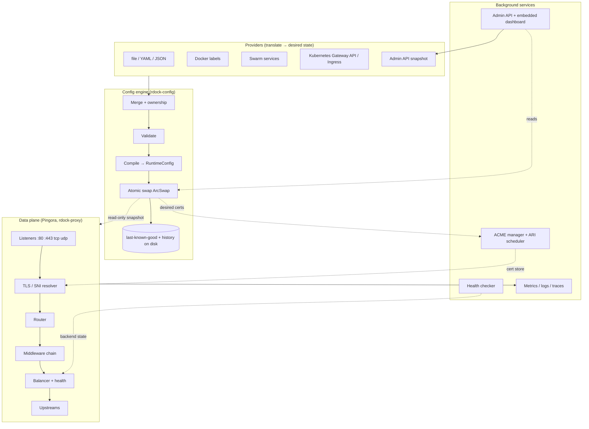
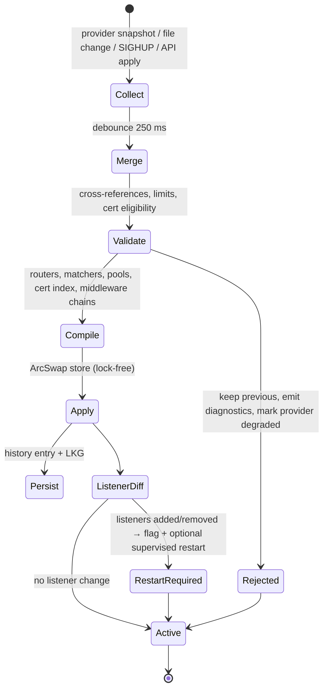
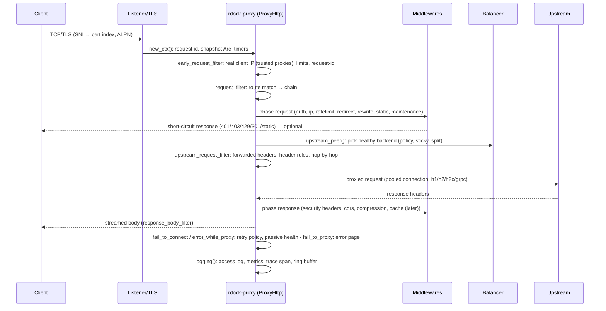
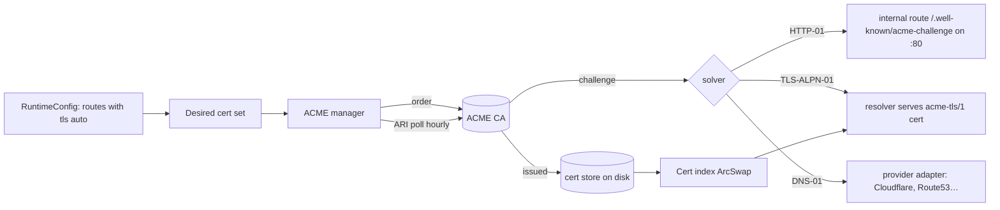

# ReverseDock — Architecture

The main engineering plan. Diagrams are Mermaid (GitHub renders them). Decisions with trade-offs are recorded as ADRs in [`decisions/`](decisions/).

## 1. Shape of the system



Rules that the diagram encodes:

1. **Everything flows one way:** providers → engine → immutable `RuntimeConfig` → data plane. The data plane never calls providers, the admin API, or disk on the request path.
2. **One process, several services.** Pingora's `Server` hosts: one HTTP proxy service per listener group, L4 services, and background services (providers, ACME, health checks, metrics, admin). All share graceful shutdown/upgrade.
3. **Optional parts are optional at runtime, not at compile time.** Docker, Swarm, Kubernetes and the dashboard are enabled in config; the default binary ships them all (Cargo feature table in [06 §2](06-repo-layout.md); `http3` is an opt-in build, and the HTTP cache is in every build because pingora-cache is compiled in anyway, ADR-0030).

## 2. Crate map

```
rdock-model          desired-state types (serde + schemars) · validation rules · JSON Schema export
rdock-rules          Traefik-v3-compatible rule grammar: parser → AST → matcher
rdock-config         loaders (yaml/json, `${…}` references) · provider registry · merge/ownership · history · LKG
rdock-proxy          compile → Runtime · own listeners/accept loops (ADR-0012) · Pingora ProxyHttp impl · router · forwarded headers · error pages · L4 proxies
rdock-tls            rustls SNI resolver · cert store/index · TLS policies · mTLS · PROXY protocol glue · local CA
rdock-acme           instant-acme client · challenge solvers (HTTP-01, TLS-ALPN-01, DNS-01) · `DnsProvider` trait · ARI scheduler · storage
rdock-balancer       BackendSelection impls (wrr, least-conn, p2c, hash) · active/passive health · retry policy · circuit breaker · outlier detection
rdock-middleware     built-ins: headers, redirect, rewrite, strip/add prefix, basic/forward auth, jwt, cors, compress, ip filter, rate limit, errors, static, maintenance, mirror
rdock-limits         token bucket · concurrency gate with queue · body/header limits · bounded-cardinality maps · calendar-window quotas persisted under the data directory (v0.8)
rdock-credentials    credential formats shared by `rdock-admin` and the data plane (v0.8, ADR-0030): admin tokens `rdk_pat_…`, API keys `rdk_<id>_<secret><crc32>`, SHA-256 of the secret, constant-time comparison, a redacting `Secret` type
rdock-observability  tracing setup · access log formatter + redaction · metrics registry · OTLP exporter · 15-min ring buffer for the dashboard
rdock-admin          v0.1: health, readiness, metrics, status, reload on its own listener · v0.5: axum API (/api/v1), OpenAPI (utoipa), auth (tokens, sessions, RBAC), SSE, embedded dashboard (rust-embed)
rdock-cloudflare     IP-range sync · Cloudflare `DnsProvider` impl (depends on rdock-acme) · Origin CA helpers (the Access JWT check is the `cloudflare_access` preset of `jwt` in `rdock-middleware`, ADR-0030)
rdock-dns-providers  DNS-01 adapters on the `DnsSolver` trait (depends on rdock-acme): Route 53 (SigV4), Google Cloud DNS (RS256 service-account JWT), Azure DNS, DigitalOcean, Hetzner Cloud, deSEC, RFC 2136 with TSIG · shared REST client, OAuth token cache, backoff, zone discovery, per-zone record-set lock (ADR-0026)
rdock-cache          HTTP cache on pingora-cache (v0.8, §19): RFC 9111 policy, memory and disk stores, tags, purge, coalescing, stale-if-error
rdock-plugins        (P2/P3) native plugin trait, WASM host (wasmtime), out-of-process agent client
rdock-control        (P3) optional control plane: config rollout ACK/NACK, shared cert storage, distributed limits
rdock-provider-file  · rdock-provider-docker · rdock-provider-swarm · rdock-provider-kubernetes · rdock-provider-api
rdock-migrate        traefik (labels + dynamic yaml) → rdock.yaml · nginx subset (later)
rdock-testkit        spawn upstream servers, Pebble ACME, toxiproxy, docker-in-CI helpers · fake provider APIs and the DNS-01 adapter contract
rdock                the binary (clap): run / validate / reload / status / config / cert / migrate / trust / version
```

Dependency direction: `rdock` → `rdock-admin`, `rdock-proxy`, providers → `rdock-config` → `rdock-model` → `rdock-rules` (the model validates `match` rules with the grammar crate). No crate depends on `rdock-admin` or on any provider. `rdock-proxy` depends on `rdock-tls`, `rdock-balancer`, `rdock-middleware`, `rdock-limits`, `rdock-observability`. `rdock-cloudflare` and `rdock-dns-providers` depend on `rdock-acme` (they implement its `DnsSolver` trait); the binary chains their provider registries.

## 3. Desired-state model (`rdock-model`)

The model is deliberately a **superset of Traefik's dynamic configuration** (entrypoints → routers → services → middlewares) so that Traefik labels, Traefik YAML and Kubernetes routes all map onto it without reinterpretation.

| Entity | Purpose | Key fields |
|---|---|---|
| `Listener` | A bound socket | `address`, `protocol` (`http`,`https`,`tcp`,`udp`), `tls` policy, `proxy_protocol`, `http3` (later) |
| `Route` | HTTP match → service | `match` (rule string **or** structured), `listeners`, `priority`, `middlewares[]`, `service` (optional when the last middleware answers every request: `static` without `pass_through`, enabled `maintenance`; ADR-0026), `tls` (`auto` / cert ref / dns provider / off) |
| `Service` | A backend pool | `backends[]` (`address`, `weight`, `unix:` sockets), `scheme` (`http`,`https`,`h2c`; gRPC rides on `h2c` or `https`), `load_balancer`, `health`, `retries`, `timeouts`, `tls` (upstream), `sticky`, `mirror`, `split[]` |
| `Middleware` | Typed, reusable policy | `type` + typed config (see §8) |
| `TcpRoute`/`UdpRoute` + `TcpService` | L4 routing | `match: HostSNI(...)`, `passthrough`, `tls` termination |
| `Certificate` | Manual cert | `cert`, `key` (paths or secret refs) |
| `Acme` | CA + challenge settings | `email`, `ca`, `profile`, `challenges[]`, `dns_providers{}`, `storage` |
| `Provider*` | Per-provider settings | docker/swarm/k8s/file/api |
| `Security` | Global trust & limits | `trusted_proxies[]`, `client_ip_header`, `limits` |
| `Admin`, `Observability` | Management & telemetry | listener, auth, log/metrics/tracing settings |

Every object carries metadata the user never writes: `owner` (`file:/etc/rdock/rdock.yaml`, `docker:myproj/app`, `k8s:ns/name`, `api`), `source_ref`, `generation`, `warnings[]`. Names are provider-namespaced like Traefik (`app@docker`, `office-only@file`); references without `@` resolve inside the same provider first, then globally if unique.

### 3.1 Canonical YAML (what a user writes)

```yaml
# yaml-language-server: $schema=https://raw.githubusercontent.com/Docker-Hunterpedia/ReverseDock/main/schema/rdock.v1.json
listeners:
  web:       { address: ":80" }
  websecure: { address: ":443", tls: { policy: intermediate } }

defaults:
  listeners: [websecure]
  redirect_http_to_https: true
  tls: auto

acme:
  email: ops@example.com
  ca: letsencrypt                 # or a directory URL; staging: true for tests
  profile: tlsserver              # classic | tlsserver | shortlived
  challenges: [http-01, tls-alpn-01]
  dns_providers:
    cf: { type: cloudflare, api_token: "${file:/run/secrets/cf_token}" }   # quoted: `{` `}` are YAML flow characters

routes:
  app:
    match: "Host(`app.example.com`)"             # Traefik grammar, or:
    # match: { hosts: [app.example.com], path_prefix: /api, methods: [GET, POST] }
    service: app
    middlewares: [secure-headers, api-limit]
  wildcard-tenant:
    match: "HostRegexp(`^[a-z0-9-]+\\.tenants\\.example\\.com$`)"
    service: tenants
    tls: { auto: true, dns_provider: cf, domains: ["*.tenants.example.com"] }

services:
  app:
    backends: [{ address: "10.0.0.5:3000" }, { address: "10.0.0.6:3000", weight: 2 }]
    scheme: http
    load_balancer: { policy: least_conn }
    health:
      active:  { path: /healthz, interval: 10s, timeout: 2s, healthy: 2, unhealthy: 3 }
      passive: { failures: 5, window: 30s, ejection: 30s }
    retries:  { attempts: 2, on: [connect, reset, timeout], budget_percent: 20 }   # status-code retries are P2 (ADR-0010)
    timeouts: { connect: 5s, read: 60s, write: 60s, idle: 90s }
  tenants:
    backends: [{ address: "unix:///run/tenants.sock" }]

middlewares:
  secure-headers: { type: headers, response: { set: { X-Frame-Options: DENY, Referrer-Policy: strict-origin-when-cross-origin } } }
  api-limit:      { type: rate_limit, key: client_ip, average: 100, burst: 200, period: 1s }
  office-only:    { type: ip_allow, cidrs: [10.0.0.0/8, 203.0.113.0/24] }
  sso:            { type: forward_auth, address: http://authelia:9091/api/verify, copy_headers: [Remote-User, Remote-Groups] }

providers:
  file:   { paths: ["/etc/rdock/conf.d/*.yaml"], watch: true }
  docker: { endpoint: unix:///var/run/docker.sock, expose_by_default: false, network: proxy, traefik_labels: true }

security:
  trusted_proxies: [cloudflare, 10.0.0.0/8]      # 'cloudflare' = auto-synced ranges
  client_ip_header: auto                          # CF-Connecting-IP on verified CF hop, else rightmost-untrusted XFF
  limits: { max_header_bytes: 32KiB, max_body_bytes: 100MiB }

admin:
  listener: 127.0.0.1:2080
  dashboard: true

observability:
  access_log: { format: json, redact: [authorization, cookie, set-cookie] }
  metrics: { prometheus: true }
  tracing: { otlp: http://tempo:4318, sample_ratio: 0.1 }
```

Everything is optional. With **no file at all**, `rdock run` starts `:80`/`:443`, the Docker provider, automatic HTTPS and the admin API on localhost.

This block is tested: it is identical to [`examples/config/rdock.full.yaml`](../examples/config/rdock.full.yaml), and CI loads it in strict mode and validates it against [`schema/rdock.v1.json`](../schema/rdock.v1.json).

## 4. Providers and the merge engine

```rust
#[async_trait]
pub trait Provider: Send + Sync {
    fn id(&self) -> ProviderId;                       // "docker", "file", "kubernetes", "api"
    async fn run(self: Arc<Self>, tx: watch::Sender<Snapshot>, shutdown: Shutdown) -> Result<()>;
    fn health(&self) -> ProviderHealth;               // Connected / Degraded(reason) / Stopped
}

pub struct Snapshot {                                  // a provider's complete view, never a diff
    pub provider: ProviderId,
    pub generation: u64,
    pub objects: DesiredState,                         // routes, services, middlewares, tcp routes …; listeners and certs only from allow-listed providers (rule 8)
    pub diagnostics: Vec<Diagnostic>,                  // unsupported labels, missing ports, …
}
```

**Merge rules (deterministic, documented, tested):**

1. A provider always emits a *complete* snapshot. The engine replaces that provider's previous contribution wholesale. Partial failure inside a provider (e.g. one container with a bad label) produces diagnostics and skips that object, never the whole snapshot.
2. Objects are namespaced by provider (`name@provider`). Two providers may define the same name; references resolve same-provider first.
3. If a provider's snapshot fails validation, the engine keeps that provider's **previous valid snapshot**, marks the provider `Degraded`, and still applies everyone else's changes.
4. Two routes with overlapping matches compile fine; evaluation order is `priority desc → rule length desc → provider priority (file > api > kubernetes > swarm > docker) → name`. The loser is flagged **shadowed** in diagnostics/dashboard.
5. A referenced object that does not exist → the referencing object is rejected with a diagnostic (`route app@docker references middleware sso@file which does not exist`).
6. The `api` provider persists its snapshot to `$RDOCK_DATA_DIR/api/snapshot.json`; it is the only provider the dashboard can write to. File/Docker/K8s objects are read-only in the UI (shown with their origin).
7. Secrets never come from labels. A label value `${file:..}` or `${env:..}` is rejected with a diagnostic.
8. A fragment carries routes, services, middlewares, TCP routes and TCP services; **only providers on an allow-list in the merge code (`kubernetes`) may also carry listeners and certificates** ([ADR-0029](decisions/0029-kubernetes-gateway-api.md)). They merge like the rest under `name@provider` keys, pass the same validator and are left out one by one when invalid. A provider listener never replaces a file listener, and one whose address a file listener already binds is left out with a diagnostic; one that cannot bind at reload time is left out too, instead of rejecting the reload, and retried with a bounded backoff (250 ms to 5 s) while its address stays in use (a file listener that cannot bind still rejects it). Docker and Swarm labels cannot open ports or name certificate files. Key material never enters a fragment: the Kubernetes provider writes each referenced TLS Secret to files in the data directory and the fragment's `certificates` entry names those files. A listener may name its own certificates (`tls.certificates`); they are served by that listener only and kept out of the shared certificate index. Provider listeners take no part in the automatic http→https redirect.


## 5. Config engine pipeline



- **Immutable snapshots:** the compiled `Runtime` is an `Arc` stored in an `ArcSwap`. Each request clones the `Arc` once in `new_ctx`; the request sees one consistent config for its lifetime even if a reload happens mid-flight.
- **Compile step** (`rdock-proxy`, also run by `rdock validate`): compiled rules (regexes, IP networks) per listener in priority order, middleware chains as `Arc<[Arc<dyn Middleware>]>`, backend pools whose DNS names are resolved in the background and shared across generations, the certificate index, and the settings v0.1 cannot honour yet as diagnostics (ADR-0014). An index for hosts and paths can replace the ordered scan when route counts call for it.
- **History:** `$RDOCK_DATA_DIR/state/history/<unix-ms>-<hash>.json` (last 50 by default, plus the diff summary). **LKG** `state/lkg.json` is loaded at boot when providers are slow/unavailable, so a reboot with Docker not yet up still serves yesterday's routes.
- **Listener changes** apply in place ([ADR-0012](decisions/0012-own-listeners-pingora-http-engine.md)): rdock binds its own sockets, so on reload new sockets are bound and TLS settings built first; only when every bind succeeds is the new configuration published. Unchanged addresses keep their socket and get new settings; removed listeners stop accepting and drain. An address a removed (or moved) listener gives up and a new listener of the same transport wants is handed over with its socket, so it never fails to bind; a removed TCP listener closes its socket at once, a removed `udp` listener keeps it while its sessions drain unless a reload needs the port, which ends the drain (ADR-0030). A port that is already in use rejects the reload and nothing changes. Zero-downtime *binary* upgrades remain the v0.9 track H-PERF-04.
- **Triggers:** file watch (notify, debounced), `SIGHUP`, `rdock reload`, `POST /api/v1/config/apply`, provider events. `rdock validate` runs the same pipeline up to *Compile* and exits non-zero on error with the diagnostics list.

## 6. Request lifecycle (Pingora hooks)



| Pingora hook | ReverseDock responsibility |
|---|---|
| `new_ctx` | Called after the request header was parsed (parser rejections never reach any hook, including `logging`). Allocate `RequestCtx { runtime: Arc<Runtime>, request_id, timings, route, middleware context }` |
| `early_request_filter` | Listener timeouts; client IP from peer + trusted proxies; header count/size, target length, `Content-Length` limits; `Host` required for HTTP/1.1; only `Expect: 100-continue`; request ID (kept only from trusted proxies) |
| `request_filter` | Path normalisation; route match in priority order (or HTTP→HTTPS redirect / 404); forwarding headers rewritten; middleware phase `request`; may answer and return `true` (earlier middlewares still run their response phase on the answer) |
| `upstream_peer` | Service lookup, split/canary pick, sticky lookup, balancer selection → `HttpPeer` with scheme, SNI, timeouts, mTLS, h2c |
| `upstream_request_filter` | Host policy (`pass_host_header`; a Host-less HTTP/1.0 request gets the backend's). Pingora has already stripped request hop-by-hop headers. v0.8: middleware phase `upstream_request` in list order, once per attempt, with the chosen backend in the context; drops `Content-Length` when a held body may be replaced (ADR-0030) |
| `upstream_response_filter` / `response_filter` | Strip response hop-by-hop headers (Pingora only cleans requests); HTTP/1.1 towards HTTP/1 clients; middleware phase `response` in reverse order; `X-Request-ID`; status-code retries (v0.4) |
| `response_body_filter` | v0.8: middleware phase `response_body` in reverse order, before compression and the throttle (cached answers included: Pingora runs it on hits; `upstream_response_body_filter` is not used); streaming gzip of the `compress` middleware (Pingora's compression module is not used: it buffers event streams and ignores q-values); custom error page bodies |
| `request_body_filter` | Body size accounting, also for chunked bodies (`max_body_bytes`). v0.8: the shared body holder (memory to 64 KiB, then an unlinked spool file) and, at the end of the stream, middleware phase `request_body` in list order; an answer aborts the upstream request (ADR-0030) |
| `fail_to_connect` | v0.4: mark connect errors retryable (`e.set_retry(true)`) when the policy allows (idempotent method or `retry_non_idempotent`, attempts left, budget available) and record the failure for passive health; v0.1 counts the error and does not retry |
| `error_while_proxy` | Resolve Pingora's "reused connection" retry state; never retry once the client saw a response; v0.4 adds the policy of ADR-0015 |
| `fail_to_proxy` | Terminal: custom error page, `Retry-After`, error metrics; no retry here |
| `logging` | Middleware phase `log` in reverse order (v0.8, read-only); access log line, metrics, OTel span end, dashboard ring buffer, audit of blocked requests |
| `request_cache_filter`, `cache_key_callback`, `cache_miss`, `cache_hit_filter`, `proxy_upstream_filter`, `response_cache_filter`, `cache_vary_filter`, `should_serve_stale` | v0.8: the HTTP cache (§19), glue in `rdock-proxy/src/cache.rs` over `rdock-cache`; no `is_purge` (purges go through the admin API) |

**Real client IP algorithm (B-NET-08/W-CF-02):** start from the TCP peer. If the peer is in `trusted_proxies`, walk `X-Forwarded-For` from right to left, skipping trusted addresses; the first untrusted one is the client. If the peer is a verified Cloudflare range and `client_ip_header: auto`, use `CF-Connecting-IP` instead. If the peer is untrusted, all forwarded headers are ignored and **overwritten** before reaching the upstream.

## 7. Routing engine (`rdock-rules`, `rdock-proxy::router`)

- Grammar (Traefik v3 compatible): `Host`, `HostRegexp`, `Path`, `PathPrefix`, `PathRegexp`, `Method`, `Header`, `HeaderRegexp`, `Query`, `QueryRegexp`, `ClientIP`, combined with `&&`, `||`, `!`, parentheses. Parsed once at compile time into an AST; `Host`/`PathPrefix` conjunctions are lifted into the host trie / path tree index so the common case is O(log n), and only the residual AST is evaluated per request.
- Regexes use the `regex` crate (guaranteed linear time); size-limited at compile; `(?i)` allowed; backreferences impossible by construction.
- Path normalisation before matching (ADR-0014, Traefik semantics): unreserved escapes decoded and others upper-cased, dot segments and `//` removed, a truncated escape is 400. The **normalised path is forwarded**. Matching uses a decoded form in which reserved characters and `%25` stay encoded, so `%2F` is never a separator.
- Priority is one number: explicit `priority`, else the rule length (Traefik semantics); ties go to provider order, then name. Shadowed routes reported.
- Structured `match` (`hosts`, `path`, `path_prefix`, `path_regex`, `methods`, `headers`, `query`, `client_ips`) compiles to the same AST, so Kubernetes `HTTPRoute` matches and Traefik rules share one engine.

## 8. Middleware model (`rdock-middleware`)

```rust
pub trait Middleware: Send + Sync {
    fn name(&self) -> &str;
    fn phases(&self) -> Phases;                                       // bitflags: REQUEST | UPSTREAM_REQUEST | RESPONSE | RESPONSE_BODY | LOG
    async fn on_request(&self, s: &mut Session, ctx: &mut RequestCtx) -> Flow;   // Continue | Respond(Response) | Reject(Status, reason)
    async fn on_upstream_request(&self, req: &mut RequestHeader, ctx: &mut RequestCtx);
    async fn on_response(&self, resp: &mut ResponseHeader, ctx: &mut RequestCtx);
    fn on_response_body(&self, body: &mut Option<Bytes>, end: bool, ctx: &mut RequestCtx);
    fn on_log(&self, ctx: &RequestCtx);
}
```

Built-ins (P0 unless noted): `headers`, `redirect` (scheme/regex), `rewrite`/`strip_prefix`/`add_prefix`/`replace_path`, `basic_auth`, `forward_auth`, `ip_allow`/`ip_deny`, `rate_limit`, `inflight_limit` (P1), `cors`, `compress` (gzip P0; br/zstd P1), `errors` (custom pages), `maintenance`, `static` (P1), `jwt` (P1), `mirror` (P1), `buffering` (P1), `cache` (P2), `wasm` (P3), `agent` (out-of-process, v0.8), `plugin` (native, v0.8). Retries and circuit breakers are **service** fields (§9), not middlewares; Traefik's `retry.*` label maps onto `services.<s>.retries` and `inflightreq.*` onto `inflight_limit`.

Chains are per route, evaluated in declared order for `request`, **reverse** order for `response` (like Traefik/Envoy onion). Each middleware declares what it needs (body? headers only?) so streaming is preserved unless a middleware explicitly buffers.

A middleware answers a request with a `Reply` whose body is in memory or, for `static`, ranges of an open file that the proxy reads and writes in 256 KiB chunks; both pass the response phase of the earlier middlewares, their compression and their `bandwidth` throttle (ADR-0026).

**Extensions (v0.8, ADR-0030).** Two kinds of middleware come from outside the built-in set:

- **Native plugins** (`type: plugin`, F-EXT-02): Rust code written against `rdock-plugin-api` (its own `0.x` crate; `http`-crate types only, no Pingora types) and compiled into a custom binary. The binary builds an explicit `Registry` (name → `Factory`) and calls `rdock::run(registry)`; `crates/rdock` is a library whose `run` is the whole command line, and the stock binary passes an empty registry. No dynamic loading (no stable Rust ABI, and `unsafe_code = "forbid"`). `compile` builds a plugin through its factory, so its configuration errors are `rdock validate` diagnostics under `middlewares.<m>.config`. An adapter in `rdock-middleware` (`plugin.rs`) wraps a `dyn Plugin` as a `Middleware`: it translates the Pingora heads into owned `http`-typed views and writes changes back, declares the plugin's capabilities, gives it typed per-request state in its slot, and catches panics in every hook (`catch_unwind` on the hook's future; the release profile unwinds): `rdock_plugin_panics_total{plugin}`, a log line and `500` for that request only. Plugins run with the proxy's privileges.
- **WASM plugins** (`type: wasm`, F-EXT-03, experimental, cargo feature `wasm`, off by default): `rdock-wasm` reads the module, checks its `sha256` pin and its minisign signature (Ed25519 on ring, BLAKE2b-512 for `ED`) before compiling it on wasmtime 36 and checking it against the WIT world `rdock:plugin/filter@0.1.0` and the granted capabilities (`log`, `clock`, `random`; `config` always; no WASI). `wasm.rs` in `rdock-middleware` creates a fresh instance per request in its state slot (`on-request`, then `on-response`, then dropped), with fresh fuel and an epoch deadline per call and a memory cap; failures are counted in `rdock_wasm_failures_total{middleware,reason}` and follow `on_error` (fail closed by default). Edits go through the same `http`-typed views as native plugins, so framing headers stay the proxy's. Without the feature the gate refuses `type: wasm`.
- **Agents** (`type: agent`, F-EXT-04, `agent.rs`): an out-of-process service asked over the existing `HttpClient`, with `protocol: rdock` (a JSON document and verdict, `schema/agent.v1.json`) or `forward` (the request replayed; 2xx allows). A request without a body is decided in the `request` phase, before routing; one with a body in `request_body`, through the shared body holder (`BodyHold` up to `max_body`), so nothing of the body reaches the backend before the verdict. The context tells a middleware whether the request has a body (`has_body`) and lets it waive its hold for one request (`waive_body_hold`, used by `on_oversize: skip`). Failures follow `on_error` (default `deny`) and feed a per-middleware circuit breaker. The data plane addresses the agent like a backend, never through the admin API or a provider (ADR-0009, ADR-0012).

**API gateway (v0.8, ADR-0030).** A request's **consumer** (`Context.consumer`: name and groups, plus `key_id`) is set by an authenticating middleware: `api_key` (keys `rdk_<id>_<secret><crc32>` from `consumers.<name>.keys`, a watched `keys_file`, or the `api` provider; refused by checksum before any lookup, found by ID in a `ConsumerIndex` compiled once per configuration, SHA-256 compared in constant time) or `cloudflare_access` (a preset over `jwt`: the user's email, or a service token's `common_name` in the group `service-token`). `Middleware::authenticates()` reports `Identity::Consumer` for both, so the cache's authentication rule accepts `key.consumer`. Later middlewares count per consumer: `rate_limit` with `key: consumer` and per-group `overrides`, and `quota` (calendar windows in UTC, counters in a process-wide `QuotaRegistry` in `rdock-limits` that outlives configurations and is written to `<data dir>/quota/` every `flush_interval` and at shutdown). A limit keyed by consumer without an authenticating middleware before it is a validation error. Every answer rdock makes itself goes through one renderer (`rdock-proxy::errorpage`): HTML by default, RFC 9457 problem details where `errors.format` asks (a `Reply` may name its `ProblemKind`, e.g. `quota-exceeded`); a middleware's own body and `errors` pages come first.

**Validation and transformation (v0.8, ADR-0030).** `validate` compiles its schemas (inline JSON Schema 2020-12, or the operations of an OpenAPI 3.1 document registered as one offline `jsonschema` resource) when the middleware is built, so a schema that does not compile is a diagnostic of `rdock validate`; parameters are checked in `request`, a JSON body in `request_body` through the shared holder. Failures are `Reply::problem(ValidationFailed)` with an `errors` extension member that the renderer adds to problem details. `transform` applies header rules and JSON Patch (`rdock-model::json_patch`) to held request bodies (`BodyVerdict::Replace`, so the proxy drops `Content-Length`) and to eligible JSON response bodies, which it collects in its state slot during the synchronous `response_body` phase and replaces at end of stream. The cache stores before any response hook, so neither changes what is stored.

**Vault references (v0.8, ADR-0030).** `${vault:<mount>/<path>#<field>}` is allowed only in secret fields, which keep the reference and resolve it at use through `rdock_config::System`. The engine reads every reference of the configuration file through the KV v2 client in `rdock-observability::vault` before each compile and puts the values into a process-wide store in `rdock-config`; a refresh task reads them again every `secrets.vault.refresh` and reloads on a change. A reference never read that fails rejects the load; a later failure keeps the stored value and marks `secrets.vault` degraded in the status.

## 9. Load balancing, health, retries (`rdock-balancer`)

- v0.1: smooth weighted round-robin (the NGINX algorithm) and weighted random in `rdock-balancer`, over every resolved address of every backend. v0.4 adds `least_conn`, `least_requests`, `p2c` and the hash policies; Pingora's selectors are not used because candidates come from our own name resolution.
- **Active health**: Pingora `HealthCheck` trait impls for HTTP(S) (status + optional body substring), TCP, gRPC health v1. Runs as a background service; state keyed by backend address survives reloads.
- **Passive health**: `fail_to_proxy`/5xx/timeouts feed a sliding window per backend → ejection for `ejection` seconds → slow-start weight ramp on return.
- **Retries** (v0.4): decided in `fail_to_connect` and `error_while_proxy` for connect failures and errors **before upstream response headers**, and in `upstream_response_filter` for 502/503/504 ([ADR-0015](decisions/0015-status-code-retries.md), no fork needed); only when (method is idempotent **or** route opts in) **and** the request body is replayable **and** `attempts < max` **and** the retry budget is not exceeded. Each retry picks a *different* backend if one is available. `error_while_proxy` never retries once the client has seen a response.
- **Circuit breaker**: per backend; closed → open after `failures` in `window` → half-open after `cooldown` with 1 probe; metrics expose state.
- **Traffic split**: `service.split: [{service: v1, weight: 90}, {service: v2, weight: 10}]` evaluated before selection; sticky cookies pin the split choice.

## 10. TLS and certificates (`rdock-tls`, `rdock-acme`)



- **Resolver:** `rdock-tls` implements `rustls::server::ResolvesServerCert`. Lookup order: ALPN `acme-tls/1` → challenge map; exact SNI; wildcard (one label); `defaults.certificate`; else the handshake fails (rustls sends `access_denied`). The index is rebuilt (cheap) on every config apply and every issuance. Our own accept loop ([ADR-0012](decisions/0012-own-listeners-pingora-http-engine.md)) gives every listener its own rustls `ServerConfig` (versions, ciphers, ALPN, client auth, tickets); Pingora's `TlsSettings` cannot set those per listener.
- **Desired-cert computation:** every `Host(...)` in a route with `tls: auto` on a TLS listener, deduplicated, grouped per route's `tls.domains` if given. `HostRegexp` hosts are *not* eligible (on-demand TLS, P2, with mandatory `ask` authorization endpoint).
- **ACME manager state machine per cert name:** `Missing → Ordering → Challenging → Issued → RenewDue(ARI window) → Ordering…`; `Failed(backoff)` with exponential backoff capped at 24 h and an alert after 3 failures. Concurrency limit per CA; duplicate suppression; staging toggle; `shortlived` (≈160 h) certificates renew roughly every 4 days (⅔ of lifetime) unless ARI says otherwise.
- **Storage:** `$RDOCK_DATA_DIR/acme/accounts/<ca>/account.json`, `acme/certs/<name>/{cert.pem,chain.pem,key.pem,meta.json}` with atomic rename; `meta.json` holds issuer, SANs, not_before/after, profile, ARI window, last error. Shared storage (S3/K8s Secret) is a P3 `CertStorage` impl.
- **Renewal:** poll ARI every hour (cheap GET). Without ARI: renew at ⅔ lifetime. Renewal failures keep serving the existing cert and raise `rdock_cert_renewal_failed` + alert.
- **Policies:** `modern` (TLS 1.3 only), `intermediate` (1.2+1.3, Mozilla list), `custom`. Session tickets with rotating keys; TLS offload pool size configurable.
- **Local dev:** `rdock trust` creates a local CA (rcgen) and installs it into the OS trust store (opt-in), like Caddy's `local_certs`.

## 11. Docker provider (`rdock-provider-docker`)

- **Connection:** `bollard` over `unix:///var/run/docker.sock`, `tcp://` or a socket proxy. Calls used: `containers/json`, `containers/{id}/json`, `networks`, `events` (filters: `container` start/stop/die/health_status/update, `network` connect/disconnect). Nothing else — a read-only socket proxy (e.g. `tecnativa/docker-socket-proxy` with `CONTAINERS=1 NETWORKS=1 EVENTS=1`) is sufficient.
- **Loop:** full list at start → stream events → re-list on each relevant event (coalesced) → periodic full reconcile every 60 s as a safety net.
- **Eligibility:** `rdock.enable=true` (or `traefik.enable=true` with `traefik_labels: true`), or `expose_by_default: true` and not `rdock.enable=false`. Stopped/unhealthy containers are kept in the snapshot with `healthy: false` so draining works.
- **IP selection:** the network named in `rdock.network`/`traefik.docker.network`, else the provider's `network`, else the single network the container is on, else diagnostic. Host-network containers have no bridge IP: the provider uses `providers.docker.host_address` (default `127.0.0.1`) and the port from `rdock.port` (required in that case).
- **Port selection:** `rdock.port` / `traefik.http.services.<s>.loadbalancer.server.port` > single `ExposedPort` > diagnostic *"container app has 3 exposed ports (80, 443, 9000); set rdock.port"*.

**Native labels** (shorthand expands to one route + one service + auto TLS):

```yaml
labels:
  rdock.enable: "true"
  rdock.host: app.example.com             # also "a.example.com,b.example.com"
  rdock.port: "3000"
  rdock.path: /                           # PathPrefix; optional
  rdock.tls: auto                         # auto | off | dns:cf (wildcard via DNS-01)
  rdock.middlewares: secure-headers@file,api-limit
  # full form, any number of routes/services/middlewares per container:
  rdock.routes.api.match: "Host(`api.example.com`) && PathPrefix(`/v1`)"
  rdock.routes.api.service: api
  rdock.routes.api.priority: "10"
  rdock.services.api.port: "4000"
  rdock.services.api.scheme: h2c
  rdock.services.api.health.active.path: /healthz
  rdock.middlewares.robots.type: headers
  rdock.middlewares.robots.response.set.X-Robots-Tag: none
```

**Traefik v3 compatibility subset (conformance-tested, v0.2):**

| Traefik label | Mapping |
|---|---|
| `traefik.enable` | eligibility |
| `traefik.docker.network` | network selection |
| `traefik.http.routers.<r>.rule / priority / entrypoints / service / middlewares` | route fields; entrypoint names map via `providers.docker.entrypoints: {web: web, websecure: websecure}` |
| `traefik.http.routers.<r>.tls`, `.tls.certresolver`, `.tls.domains[n].main/sans` | `tls: auto` (any resolver name → default ACME), explicit SANs |
| `traefik.http.services.<s>.loadbalancer.server.port / scheme / url`, `.passhostheader`, `.sticky.cookie.*`, `.healthcheck.*`, `.passivehealthcheck.*`, `.strategy`, `.serverstransport` (warn) | service fields |
| `traefik.http.middlewares.<m>.headers.*`, `redirectscheme.*`, `redirectregex.*`, `stripprefix.*`, `addprefix.*`, `replacepath.*`, `replacepathregex.*`, `basicauth.*`, `ratelimit.*`, `ipallowlist.*`, `compress.*`, `forwardauth.*`, `errors.*`, `inflightreq.*`, `passtlsclientcert.*` | middleware types; `retry.*` becomes `retries` of the router's service |
| `traefik.tcp.routers.<r>.rule (HostSNI) / entrypoints / tls.passthrough`, `traefik.tcp.services.<s>.loadbalancer.server.port` | L4 (v0.6) |
| anything else (`plugin.*`, `chain`, `digestauth`, `circuitbreaker` …) | **diagnostic warning** with the exact label, visible in `rdock status` and the dashboard |

## 12. Swarm and Kubernetes (summary)

- **Swarm** (`rdock-provider-swarm`, P1, [ADR-0026](decisions/0026-swarm-l4-static.md)): the Docker provider's translator over running tasks; labels from `Spec.Labels` (Compose `deploy.labels`); events for services, nodes, networks, secrets and configs plus a task poll every `poll_interval` (5 s), because tasks emit no events. Endpoint mode `tasks` (default: each running task's address, our health checks, sticky sessions, drain on `DesiredState: shutdown`) or `vip` (the service VIP, Swarm balances). Network: label, provider setting, or the one overlay network shared with the proxy, never `ingress`. Replicas share nothing until v0.9: one ACME replica, or global mode with certificates from secrets.
- **Kubernetes** (`rdock-provider-kubernetes`, P2, [ADR-0029](decisions/0029-kubernetes-gateway-api.md), [research](research/v0.7-kubernetes.md); implemented; passes the upstream Gateway API v1.7.0 conformance suite in CI on kind for GATEWAY-HTTP, GATEWAY-GRPC, GATEWAY-TLS and GATEWAY-TCP, all core tests and every claimed extended feature, 2026-11-11, commit 19e88cc, and for GATEWAY-UDP (added in v0.8; core 21 and extended 7 passed), 2026-11-12, commit 43d81de; not released yet; no report submitted upstream yet): a Gateway API controller and the data plane in the same binary and the same Deployment; there is no mode flag, the `providers.kubernetes` section is the switch (the earlier `--mode kubernetes` wording is dropped). Built on `kube` 5.0.0 (rustls with ring) and k8s-openapi 0.29; the Gateway API v1.7.0 Standard kinds (`v1` only) are **our own types** with only the fields we read, not the `gateway-api` crate (which needs Rust 1.92 and is generated from an older release). Like the Docker provider it splits into a pure `translate(&Inventory, &Settings) -> Translation` (fragment with listeners, certificates, routes, services and middlewares; diagnostics; the desired status of every object; the desired per-Gateway Services) and a runtime half: one watcher per kind, translation at most every 100 ms, a snapshot published only when it differs, the last snapshot kept when the API server is away. **One Service per Gateway** in the controller's namespace maps each listener port to an internal port from `gateway.port_range`; the Service's ports are the record of the allocation, every replica opens exactly those internal listeners, and the Gateway's address is the Service's. **Every replica serves; only the Lease holder writes** status and the Services (own Lease loop with client-go's timings; serving and readiness never depend on leadership, and a replica is Ready after its first full sync). Status is a merge patch that preserves other controllers' conditions and `parents` entries. TLS Secrets become files (memory-backed in the chart) and never enter the stored configuration; cert-manager is the supported certificate source, and `acme` together with the provider is refused unless `allow_acme`. RBAC is read-only on what is translated and writes only `*/status`, one Lease and Services in one namespace; never pods, nodes or Secrets. `GatewayClass.status.supportedFeatures` lists only the features the translator claims (`features.rs`). ListenerSet listeners join their parent Gateway's when it allows them. UDPRoute is supported on `UDP` listeners since v0.8 (ADR-0030). Not supported: `timeouts.request` and `retry`, TLSRoute `Terminate`. `Ingress` v1 is a translation layer for migrations (off by default; the ingress-nginx annotations that map one to one onto a middleware are honoured, the rest reported, `*-snippet` refused). Delivered by a Helm chart (`deploy/helm/reversedock`), raw manifests and a Kustomize base.

## 13. Admin API and dashboard (`rdock-admin`)

[ADR-0024](decisions/0024-management-api-and-dashboard.md) is the authoritative design for v0.5 and refines this section: own 2-thread runtime, loopback by default with TLS required elsewhere, optional mTLS remote admin and a Unix socket for the CLI, Host/Origin checks, single-use bootstrap token, TOTP MFA, `__Host-` session cookies, `rdk_` tokens stored hashed, the role matrix, a hash-chained audit log and mandatory `If-Match` on writes.

- Separate `axum` server on `admin.listener` (default `127.0.0.1:2080`); exposing it on a proxy route requires an explicit route + middleware (e.g. `forward_auth`) — never implicit.
- **Auth:** bootstrap token printed/written at first start (`$RDOCK_DATA_DIR/admin/bootstrap-token`); users with argon2id passwords (dashboard sessions: `SameSite=Strict` cookie + CSRF token); API tokens with scopes `read`, `write`, `admin`, optional expiry and IP allow-list; roles `viewer`, `operator`, `admin`. Every write is audit-logged (`who, when, what, diff hash, result`).
- **Resources (`/api/v1`):** `config` (GET effective, PUT replace API snapshot, PATCH, `POST /config/validate`, `/config/apply`, `/config/history`, `/config/rollback/{id}`), `routes`, `services`, `middlewares`, `certificates` (`POST /certificates/{name}/renew`), `listeners`, `providers` (status + diagnostics), `backends` (health, drain/undrain), `logs/stream` (SSE), `events/stream` (SSE), `metrics/summary` (ring buffer), `cache` and `cache/{store}/purge` (v0.8, §19), `users`, `tokens`, `audit`. OpenAPI 3.1 served at `/api/openapi.json`.
- **Dashboard:** static SPA embedded with `rust-embed`, served at `/` of the admin listener, talks only to `/api/v1`, makes **no external requests** (fonts and icons bundled). See [design system](08-design-system.md).

## 14. Observability (`rdock-observability`)

- **Access log** (JSON, one line per request): `ts, request_id, trace_id, client_ip, method, host, path, query(len), proto, status, bytes_in, bytes_out, duration_ms, upstream_addr, upstream_connect_ms, upstream_ttfb_ms, route, service, listener, tls_version, tls_cipher, sni, user_agent, referer, cf_ray, retries, cache_status, error`. Redaction list applied before serialisation; sampling by status class.
- **Metrics** (Prometheus): `rdock_http_requests_total{listener,route,service,method,status_class}`, `rdock_http_request_duration_seconds` (histogram), `rdock_upstream_duration_seconds`, `rdock_upstream_backend_healthy{service,backend}`, `rdock_upstream_connections{...}`, `rdock_tls_handshakes_total{version,resumed}`, `rdock_cert_expiry_timestamp_seconds{name}`, `rdock_cert_renewal_failed_total`, `rdock_ratelimit_rejected_total{middleware}`, `rdock_config_generation`, `rdock_provider_state{provider}`, process/Tokio runtime metrics. Label cardinality is bounded by config (route/service names), never by host/path values.
- **Consumers and metering (v0.8, ADR-0030):** the access log carries `consumer` and `key_id`; `rdock_consumer_requests_total{consumer,route,status_class}` counts per consumer with at most 1,000 consumer label values (then `_other`). `observability.metering` builds one event per request with a consumer in the `logging` hook and only pushes it into each sink's bounded queue (`try_send`; a full queue drops and counts `rdock_metering_dropped_total`); a task per sink batches and sends CloudEvents 1.0 to a webhook (Standard Webhooks signature, the alert webhook client with its private-address guard) and/or OTLP/HTTP logs, retrying with the same event IDs (at least once). No disk spool.
- **Tracing:** `tracing` spans per request; OTLP export; `traceparent`/`tracestate` propagated to upstream; `baggage` optional.
- **Dashboard feed:** a 15-minute ring buffer of per-second counters and a fixed 40-bucket logarithmic latency histogram per route (about 183 KiB per route; [ADR-0024](decisions/0024-management-api-and-dashboard.md) replaced the DDSketch plan) — no Prometheus needed for live charts.

## 15. Security model

| Threat | Control |
|---|---|
| Client-IP spoofing | Forwarded headers trusted only from `trusted_proxies`; Cloudflare ranges auto-synced and verified; untrusted headers stripped |
| Request smuggling / desync | Pingora 0.9 rejects conflicting `Content-Length`, bad `Transfer-Encoding`, obs-fold and bad authorities and re-frames every forwarded body; rdock adds `Host` for HTTP/1.1, bare-LF and `Expect` refusal and a header deadline; the e2e suite replays the smuggling catalogue and a differential fuzz target (`tests/fuzz`) checks forwarded framing |
| Admin takeover | Localhost bind, tokens with scopes, rate-limited login, audit log, no default credentials, CSRF on sessions |
| Docker socket abuse | Read-only API usage, socket-proxy docs, no `exec`/`create` calls, labels cannot inject secrets |
| Certificate abuse (on-demand TLS) | Disabled by default; requires `ask` endpoint; per-IP issuance rate limits |
| Path traversal in static | Canonicalised root, symlink policy, deny dotfiles by default |
| Resource exhaustion | Header/body/URI limits, bounded HTTP/2 streams/windows, connection and inflight limits, rate limiter with bounded key cardinality, timeouts everywhere |
| Secrets leakage | Redaction in logs, secrets referenced by path, never echoed by API (`***`), config export masks them |
| API key theft or leakage (v0.8) | Keys stored as ID and SHA-256 of the secret only; the clear-text key exists in the answer to its creation alone, never in snapshots, history, audit, logs or diagnostics (an e2e test checks every place); removed before the request goes upstream; a CRC32 checksum refuses typos without a lookup; constant-time comparison; query-string keys only when configured, never cookies |
| OIDC login abuse (v0.8) | PKCE S256 always, `state` compared in constant time and `nonce` per login in an encrypted 10-minute state cookie; the ID-token checks of OpenID Connect Core §3.1.3.7 (algorithms configured ∩ advertised, never `none`, HMAC only when listed) and RFC 9207 `iss`; post-login targets are local paths taken from the request itself, never from a parameter (no open redirect); redirect URIs only from the route's `Host` names or an explicit `redirect_url`; session and state cookies sealed with ChaCha20-Poly1305 under HKDF keys bound to purpose and relying party, `__Host-`, `Secure`, `HttpOnly`, `SameSite=Lax`, rotation by key list, a fuzz target on the decoder; rdock's cookies and client copies of identity headers removed before the backend; `401`, not a redirect, for non-navigations; the provider's endpoints refused on private addresses unless allowed; `error_description` never echoed. Stateless sessions cannot be revoked early (short `ttl`; server-side sessions wait for shared state) |
| Supply chain | `cargo-deny`, `cargo-audit`, pinned deps, signed releases, SBOM, minimal images |
| Memory safety | Rust, `#![forbid(unsafe_code)]` in all `rdock-*` crates; unsafe only in audited dependencies |

## 16. Performance design

- One Tokio multi-thread runtime (a worker per core) with our own accept loops, one per listener (ADR-0012); TCP_NODELAY on accepted sockets.
- Hot path allocations: route match without allocation (borrowed `&str` on trie), header mutations in place, `Bytes` body passthrough, middlewares declare body needs.
- Lock-free config reads (`ArcSwap`), sharded rate-limit maps, atomics for counters, DDSketch for latency.
- TLS: session resumption with rotating ticket keys, ECDSA certs by default (smaller handshakes), the ring provider ([ADR-0013](decisions/0013-tls-crypto-provider-ring.md)).
- Connection pooling per `HttpPeer` with limits and idle eviction; HTTP/2 upstream multiplexing where the backend supports it.
- Benchmarks (`benchmarks/`) run `oha`/`wrk2`/`k6` scenarios against identical NGINX/Traefik/Caddy/HAProxy configs in Docker with pinned CPUs; results published per release.

## 17. Layer 4 (`rdock-proxy::l4`, P1)

- `listeners.<name>.protocol: tcp` uses our own accept loop like HTTP listeners ([ADR-0012](decisions/0012-own-listeners-pingora-http-engine.md), [ADR-0026](decisions/0026-swarm-l4-static.md)), with a different per-connection `serve()`; a `udp` listener is a Tokio `UdpSocket` receive loop in the same listener lifecycle ([ADR-0030](decisions/0030-v0-8-cache-extensibility-gateway.md)).
- TCP, per connection: PROXY protocol v1/v2 (only from the listener's `trusted` sources, required once trusted, shared with HTTP listeners) → optional `starttls: postgres` → ClientHello peek with our own parser (reassembled across records, 16 KiB cap, rewound) → `HostSNI`/`HostSNIRegexp`/`ALPN`/`ClientIP` match → passthrough or termination with the listener's rustls acceptor → `tokio::io::copy_bidirectional` under an idle timeout and a termination delay; outbound PROXY header per service; `rdock_tcp_*` metrics.
- UDP (`rdock-proxy::udp`, M-L4-04): one receive loop per listener socket and a session table keyed by the client address (IP and port) on that listener. A session owns a socket connected to one backend, chosen once by the balancer (weights, `round_robin`/`random`/`least_sessions`/`ip_hash`), and a task that relays the backend's datagrams back through the listener socket; client datagrams reach it through a bounded queue (64, full: dropped). A session is created only after, in order, a route matches (`ClientIP` rules or none), `ip_allow`/`ip_deny` admit the client, the listener's caps have room (`sessions.max` 4,096 and `max_per_client` 64 by default, `unlimited` to lift) and a backend is available; anything else is dropped and counted (`rdock_udp_dropped_total{listener,reason}`), never answered. It ends after `timeouts.idle` (60 s) without traffic either way, after `responses` replies, on ICMP "port unreachable" (`ECONNREFUSED` on the connected socket, which feeds passive ejection), or when the listener closes after `lifecycle.drain_timeout`; `requests` detaches it from its client early. Buffers are 64 KiB; a datagram too large for the destination's address family is counted as `oversize`, never cut. Reloads keep sockets and sessions of unchanged listeners. Replies leave from the listener socket, so a wildcard bind on a multi-homed host may answer from another address (documented; `IP_PKTINFO` would need `unsafe` or quinn-udp). PROXY protocol for datagrams, GRO/GSO and `SO_REUSEPORT` fan-out are out of scope. Metrics `rdock_udp_sessions`, `rdock_udp_datagrams_total`, `rdock_udp_bytes_total`, `rdock_udp_dropped_total`, `rdock_udp_session_ends_total`.
- Shares `rdock-balancer` (backend selection, TCP health checks also for UDP services, passive ejection) and `rdock-limits` (TCP connection caps; UDP has its own session caps).

## 18. HTTP/3 track (P3, experimental)

- Cargo feature `http3`; build variant with BoringSSL (`pingora` `boringssl` feature) + `tokio-quiche`. The default build stays rustls-only.
- Ingress first: a UDP socket on the same port as the TLS listener, QUIC handshake with the same cert index. Pingora's server `Session` is a closed H1/H2 type, so feeding h3 into `ProxyHttp` needs either a maintained `pingora-core` patch (what PR #514 did) or an h3 front-end forwarding over an internal h2c hop into the normal pipeline; the track starts with the hop (no fork) and measures its cost. `Alt-Svc: h3=":443"` injected by `rdock-proxy`. Upstream HTTP/3 is out of scope until Pingora provides a connector.
- Ships as "experimental" until h3i/quiche interop tests and soak tests pass.

## 19. HTTP cache (F-WEB-03, ADR-0030)

**Crates.** `rdock-cache` owns every use of `pingora::cache` (pingora-cache 0.9.1, which `pingora-proxy` already builds; the facade's `cache` feature only re-exports it): RFC 9111 policy as pure functions, the stores, the tag and URL index, the coalescing lock and the metrics handles. `rdock-proxy/src/cache.rs` is the hook glue; `rdock-model` has `caches.<name>` and the `cache` middleware; `rdock-admin` serves statistics and purges.

**Where the cache runs.** Pingora 0.9.1 calls `request_filter` (every middleware's `request` phase), then the cache (`request_cache_filter` → `cache_key_callback` → lookup → `cache_vary_filter` → `cache_hit_filter`), and only on a miss `proxy_upstream_filter`, `upstream_peer` and `upstream_request_filter` (the `upstream_request` phase). `upstream_response_filter` runs before `response_cache_filter`, so the store holds the origin's response without hop-by-hop fields and before any response middleware; `response_filter`, `response_body_filter` and `logging` run on hits too. Consequences: authentication, IP filters and rate limits apply to every hit; `compress` encodes stored objects on the way out; the `cache` entry's position in a route's list does not matter, and it is a no-op middleware that carries the configuration compiled into `RouteRuntime.cache`.

**Configuration and lifetime.** Stores are process-lifetime `&'static` objects (pingora-cache requires it), created once per name by a registry in the `DataPlane` and reused on reload; adding a store applies on reload, changing or removing one is a warning that takes effect after a restart while the old store keeps serving. Validation never opens a store. The middleware's policy reloads freely, and objects survive reloads.

**Policy we add to Pingora's mechanism.** Storability (methods, request bodies, a status allow-list, `no-store`, `private`, `Vary: *`, `Set-Cookie`, `Authorization` per §3.5), no default lifetime, the origin's `Age` and `Date` through an epoch override (§4.2.3), the full `304` header update (Pingora merges five fields; we merge every field the `304` carries except framing, connection and cookie fields), request directives in `cache_hit_filter` (`ForceExpired`, `ForceFresh`, `ForceMiss` for `only-if-cached` → `504` from `proxy_upstream_filter`), normalised variance, invalidation after successful unsafe methods (§4.4) in `upstream_response_filter`, `stale-if-error` through `should_serve_stale` (never for `stale-while-revalidate`: background subrequests would re-run the pipeline; the setting is refused as planned), `Cache-Status` (RFC 9211) and `cache_status` in the access log. The key is length-framed: store, route, client scheme, lower-cased host, forwarded path, the query after `key.query`, method class, `key.headers`, `key.consumer`.

**Coalescing.** pingora-cache's lock with one change: a writer that fails releases its waiters (`GiveUp`) instead of electing one of them to try again, so a failing origin is never asked once per waiter in turn. Waiters wait at most `lock.timeout`, which is also how long a writer holds the lock; no partial reads for waiters.

**Stores.** Both index objects (LRU order, URL index, bounded tag index, fills in progress that a purge cancels before they commit). *Memory:* reference-counted body chunks under one mutex, LRU by size. *Disk:* one file per object at `ab/cd/<32 hex digits>` below a root opened with cap-std and created `0700`; the file is a 32-byte prefix (magic, version, lengths, CRC-32s), a header block (key, variance, URL, tags, pingora-cache's serialised `CacheMeta`) and the body; written under a temporary name in the same directory and renamed when complete; blocking I/O on Tokio's blocking pool in bounded chunks; a start-up walk rebuilds the index, removes temporary files, drops damaged files (counted) and enforces `max_size` and `max_objects`; a `304` rewrites the head into a new file. No `fsync`: a power loss may lose recent objects, never serve damaged ones. This replaces the earlier plan of `pingora-memory-cache` plus segmented files: `pingora-memory-cache` does not implement `Storage`, and a segmented log needs its own compaction and recovery.

**Purge.** Only through the admin API (`POST /api/v1/cache/{store}/purge` by URL, prefix, tag or all; operator role, audited, rate-limited with configuration writes); no `PURGE` method on the data plane. A purge reaches one instance until the v0.9 control plane.

## 20. Failure modes (what happens when…)

| Failure | Behaviour |
|---|---|
| Docker socket unavailable at boot | Load LKG snapshot; provider `Degraded`; retry with backoff; dashboard banner |
| Docker socket drops at runtime | Keep last Docker snapshot; keep serving; events resume on reconnect + full reconcile |
| Config file invalid | Reject only the file provider's snapshot; previous stays; `rdock validate` exit code 1 |
| ACME CA down / rate-limited | Serve existing certs (even near expiry); backoff; alert; self-signed fallback only for brand-new hosts if `acme.fallback_self_signed: true` |
| Backend down | Passive ejection, retries to other backends, 502/503 page, health metric |
| All backends down | `503` error page (configurable), `Retry-After`, circuit open |
| Admin API / dashboard crash | Separate task; data plane unaffected; supervisor restarts the admin service |
| Disk full (logs/history) | Logs to stdout unaffected; history write failure logged, not fatal; cert writes use pre-checked free space |
| Reload adds or changes a listener | Applied in place: new sockets first, then the configuration; a port already in use rejects the reload and nothing changes (ADR-0012). A listener contributed by a provider (Kubernetes) that cannot bind is left out with a diagnostic instead, and retried until it binds (ADR-0029). An address a removed listener gives up is handed to its successor (ADR-0030) |
| Process receives SIGTERM | Stop accepting, finish open requests (`Connection: close`, HTTP/2 GOAWAY), close idle connections, exit as soon as nothing is open or `lifecycle.drain_timeout` passes |
